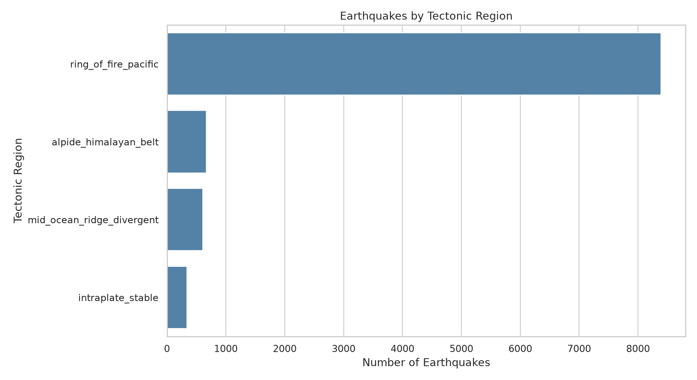
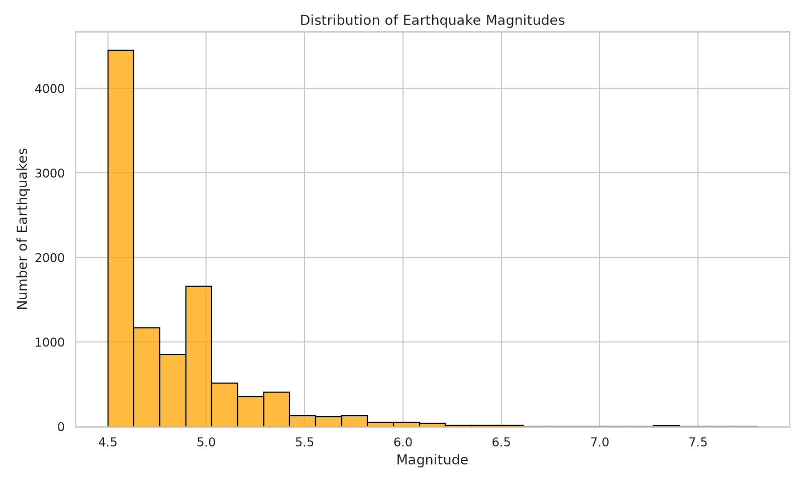
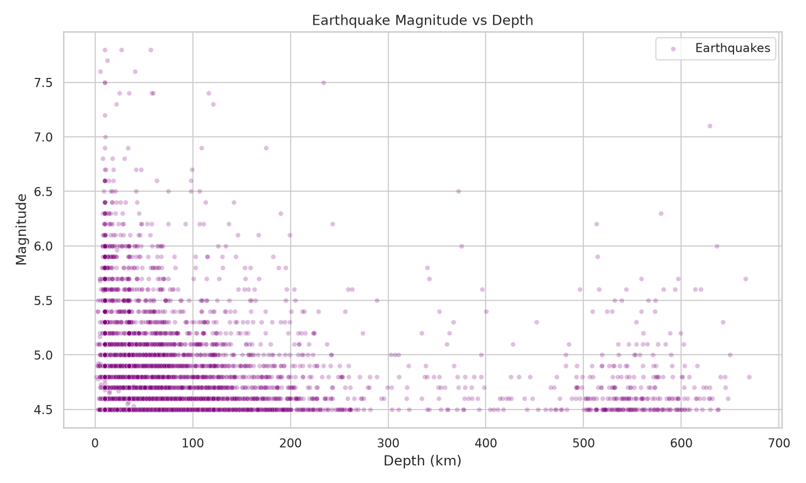
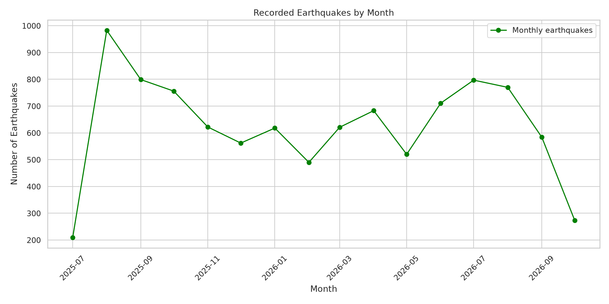
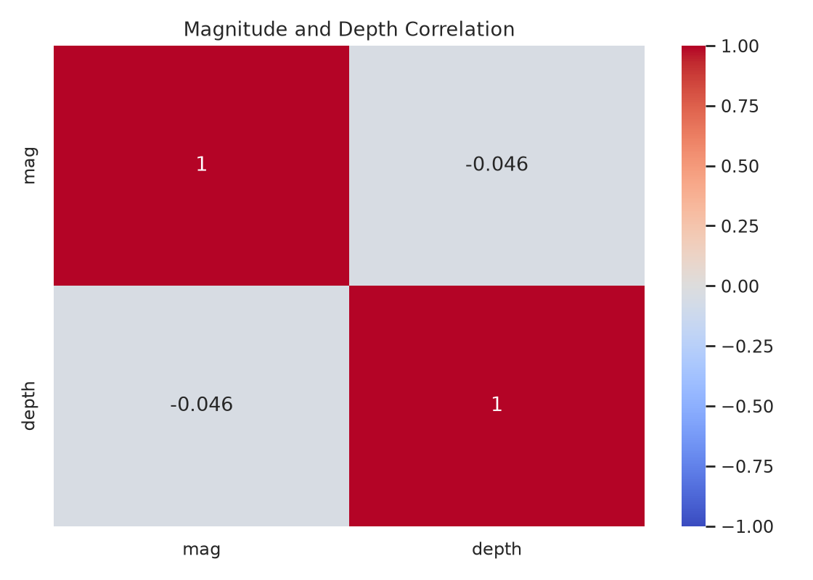

# Global Earthquake Analysis with Python

## Project overview and research question
How can I use Python to gain insights into earthquake magnitude, depth, tectonic location, and frequency?

## Dataset and source
**Source/provenance note:** The original CSV was supplied by the project author. Its original public download URL has not been established; the USGS link below is a reference, not a verified source for this exact file. This is a remaining provenance limitation under the assignment's public-source requirement.

This project uses the provided `global_earthquakes_seismic.csv` file (10,000 rows, 25 columns). The exact original download source of this file has **not been verified**. The [USGS Earthquake Catalog](https://earthquake.usgs.gov/earthquakes/search/) is a reputable reference for public earthquake data, but it is not confirmed as the source of this specific file. The dataset includes derived tectonic classification fields. Results apply to the supplied sample, not necessarily all global earthquakes.

## Data ingestion
I loaded the original CSV into a Pandas DataFrame using `pd.read_csv("global_earthquakes_seismic.csv")`. This allowed me to inspect the rows and columns before cleaning and analyzing the data. The cleaned data was then saved to `global_earthquakes_cleaned.csv` for use in the analysis script.

## Data cleaning
I checked missing values, duplicates, event types, data types, and coordinate ranges. The original file had no missing values or duplicate event IDs. I removed two landslide records, converted Unix millisecond timestamps to UTC datetimes, added year/month/date fields, and removed redundant narrative fields. The cleaned dataset has **9,998 earthquakes** and 25 columns. The script also filters negative depths and magnitudes as a project-specific decision.

## Data manipulation
- **Sorting:** ranked events by magnitude to find the largest earthquakes.
- **Filtering:** selected events with magnitude 6.0 or higher to focus on stronger earthquakes.
- **Grouping:** calculated earthquake counts, average magnitude, and average depth by `tectonic_boundary_zone` to compare different regions.

## Visualizations
These five charts were generated from the uploaded CSV with Matplotlib and Seaborn using `earthquake_analysis.py`.

### Earthquakes by tectonic region

### Magnitude distribution

### Magnitude vs depth

### Earthquakes over time

### Correlation heatmap

## Statistical analysis
- Mean magnitude: **4.81**; median: **4.70**; mode: **4.5**; standard deviation: **0.37**.
- Mean depth: **56.18 km**; median depth: **11.00 km**.
- Pearson magnitude-depth correlation: **-0.046**, showing little linear association in this sample.
- Magnitude skewness: **2.254**.
- Magnitude 6.0+ events: **170** (**1.70%** of cleaned events).

## Key findings
The largest category in the supplied tectonic zone field is **ring_of_fire_pacific**, with **8,388 events (83.9%)**. Magnitude and depth have almost no linear correlation in this sample. The monthly line chart shows how counts vary over the observed date range, but partial first/last months and sample selection can affect interpretation.

## Conclusion
Python made it possible to clean a real-world dataset, sort and filter earthquake events, compare tectonic zones, calculate summary statistics, and visualize patterns. These results describe the records in this dataset and should not be used to predict earthquakes or infer global rates without verifying sampling and provenance.

## Tools
Python, Pandas, NumPy, Matplotlib, and Seaborn. Run `earthquake_analysis.ipynb` in Google Colab or run `python clean_earthquake_data.py` followed by `python earthquake_analysis.py` locally.

## Files
- `global_earthquakes_seismic.csv`: original data
- `global_earthquakes_cleaned.csv`: cleaned data
- `clean_earthquake_data.py`: cleaning script
- `earthquake_analysis.py`: manipulation, statistics, and visualization script
- `earthquake_analysis.ipynb`: Google Colab notebook
- `visualizations/`: five PNG charts
